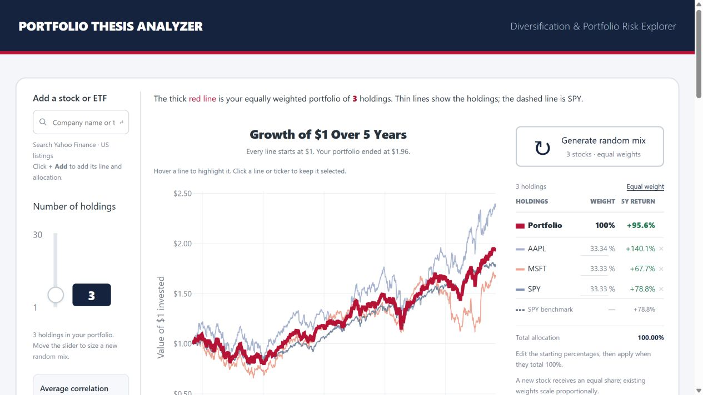
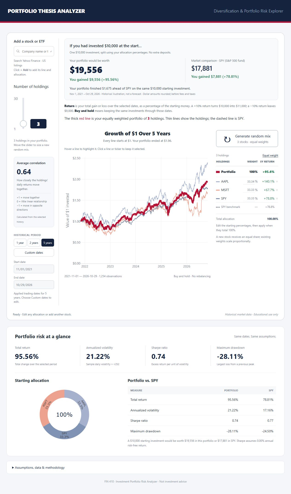
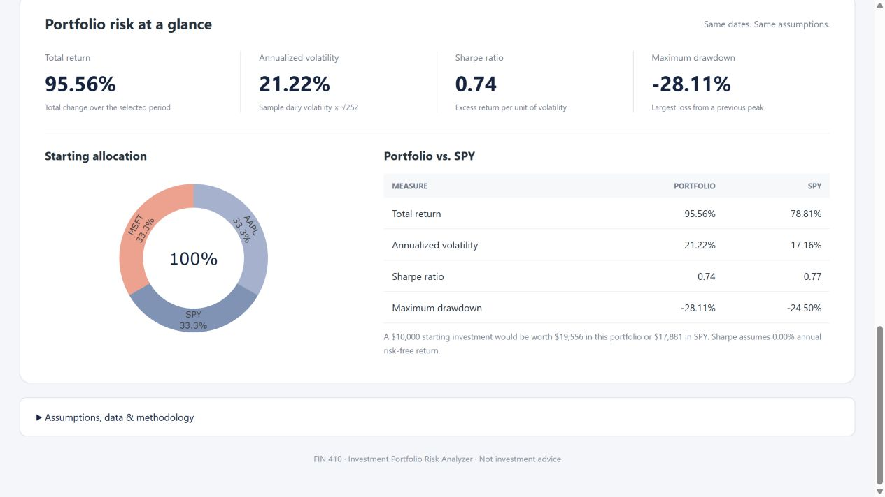

# Portfolio Thesis Analyzer

**FIN 410 — Project 2: Investment Portfolio Risk Analyzer**

A local, interactive finance prototype that shows how securities and allocations
change portfolio performance and risk. Its navy header, red portfolio line, thin
security lines, vertical controls, and holdings table follow the supplied reference.
The screen uses **real historical data**, not the reference image's synthetic stocks.
Below the main chart, the result shows what a hypothetical **$10,000 starting investment** became,
the dollar gain or loss, the total percentage return, and the same investment in
SPY. Values update whenever the holdings, weights, or dates change. This is a
historical illustration before fees and taxes, not a forecast. Dollar amounts in
the headline are rounded to whole dollars.

## Run it

Python 3.12 is tested. From this folder:

```powershell
python -m venv .venv
.\.venv\Scripts\python.exe -m pip install -r requirements.txt
.\.venv\Scripts\python.exe app.py
```

Open **http://127.0.0.1:8501**. On the original development computer, the environment
is already installed: double-click **Start Portfolio.bat**. It opens the browser
after the server starts, or reopens the app if it is already running. Keep the terminal open;
Ctrl+C stops the server. On macOS/Linux use `.venv/bin/python` in place of
`.venv\Scripts\python.exe`. Recreate .venv rather than copying it between computers.

The redesign uses a small custom HTML/CSS/JavaScript interface and Python's built-in
HTTP server. **Streamlit is no longer required, and `streamlit run app.py` is no
longer the launch command.** No Node install/build, account, database, API key, or
paid AI API is required. Plotly JavaScript is served locally from the installed
Python package. Internet access is needed to search and download market data.

## The intended interaction

1. Type a company name (such as Tesla) or ticker in **Add a stock or ETF**.
   Search queries Yahoo Finance; results show company name, ticker, and exchange.
   Click **+ Add** on a result to add exactly that security. A confirmation names
   its starting allocation, its holdings row is marked NEW, and its chart line is
   automatically highlighted. It is not limited to the random
   selection universe. Search supports US-listed equities and ETFs only.
2. The new holding receives 1/(new holding count) of starting capital. Existing
   weights scale proportionally into the remaining allocation. For example,
   40/35/25 becomes 30/26.25/18.75/25 after adding a fourth stock.
3. Starting allocation percentages are always visible in the holdings table.
   Edit them directly. Changes are **drafts** until their sum is exactly 100% and
   you click **Apply weights**. The chart and risk measures retain the last applied
   portfolio in the meantime; the interface labels this explicitly. Other portfolio
   actions are disabled during a draft. Cancel discards edits.
4. For the assignment example, set AAPL to 40, MSFT to 35, and SPY to 25, then Apply.
   No automatic normalization changes those requested percentages.
5. **Equal weight** resets all starting allocations. The x beside a holding removes
   it and redistributes the allocation proportionally to the remaining holdings.
   At least one holding must remain; a prompt reminds you to use at least three
   for the assignment. Zero allocations are allowed, but the total must be 100%.
6. The **Number of holdings** slider follows the actual portfolio count after
   loading, adding, removing, or generating holdings. To size a new random mix,
   move the slider, then click **Generate random mix**.
   This replaces the portfolio with 1–30 unique US equities and equal allocations.
   One stock receives 100%; correlation is N/A until at least two holdings have
   positive allocations. The assignment reminder to use at least three remains.
   Moving the slider alone does not change the current holdings. While its value
   differs from the portfolio, the hint explicitly shows both the actual count
   and the next random-mix size. The holdings panel always shows the actual count.
7. Choose **1 year**, **2 years**, or **5 years**. Start/end dates are always visible
   and automatically show the actual common trading dates used by that preset.
   They update if adding or removing a holding changes the available common history.
   For a different range, use the separate **Custom dates** button, enter a start
   and end date, and click **Apply range**. Both dates are inclusive. Weekends and
   holidays use only available trading dates within the chosen range. The chart,
   returns, risk measures, and SPY comparison all use the same common dates and
   restart at $1 on the first common observation. At least three common prices
   are needed. Future dates and reversed ranges are rejected. Date edits leave
   the last applied chart intact until Apply; Cancel restores the applied range.
   Adding holdings or editing weights preserves the applied date range.
   See risk, allocation, and benchmark comparison
   immediately below the main chart. Average correlation is a read-only number
   card with a short explanation of −1, 0, and +1; it has no slider or editable control.
8. Hover a performance line to make it stand out and show its ticker, date, growth,
   and return. Click a line or ticker in the holdings table to keep it highlighted.
   Click it again, choose **Clear selection** above the chart, or press Escape to clear the selection.
   Highlighting only changes the display, never the allocations or calculations.

Allocation percentages have two-decimal precision and sum to exactly 100.00%.
Equal weights use largest-remainder rounding (e.g. 33.34/33.33/33.33) so displayed
percentages match the calculations. A failed search/add/download leaves the last
successful portfolio intact. Nothing is traded or sent to a brokerage.

## Requirement coverage

| Project 2 feature | Implementation |
|---|---|
| Select at least three stocks or ETFs | Live company/ticker search, defaults to AAPL/MSFT/SPY, supports up to 30 |
| Investment amounts or portfolio weights | Always-visible editable starting weights and explicit Apply |
| Portfolio returns | Buy-and-hold growth series, total period return, growth of $10,000 |
| Annualized volatility | Sample daily return standard deviation × sqrt(252) |
| Sharpe ratio | Mean daily excess return / sample daily volatility × sqrt(252) |
| Maximum drawdown | Worst decline from a running peak, including initial capital |
| Allocation and performance charts | Starting allocation donut; individual/portfolio performance lines |
| Market benchmark | SPY dashed line and same-period risk/return comparison |

## Working application screenshots







## Files

- `app.py`: HTTP entry point, static assets and JSON routes; defaults to loopback only.
- `web/index.html`, `web/styles.css`, `web/main.js`: browser interface.
- `service.py`: validates state, changes allocations, assembles financial results.
- `portfolio.py`: price alignment, buy-and-hold calculations, and risk metrics.
- `market_data.py`: historical download, live search, and caching.
- `test_app.py`, `test_portfolio.py`: deterministic application/calculation tests.
- `requirements.txt`: pinned Python dependencies.

Local routes: `GET /api/search?q=company`, `POST /api/analyze`, and `GET /health`.
`/api/analyze` takes holdings, integer allocation basis points totaling 10,000,
period (`1y`, `2y`, `5y`, or `custom`), annual risk-free assumption, and an optional action.
Custom ranges also require `start_date` and `end_date` in YYYY-MM-DD form. Invalid requests
return a descriptive error; changes are committed to the UI only on success.
The built-in server is appropriate for this local prototype, not a production
multi-user hosting configuration. Public deployment remains a separate step.

## Data APIs

The app uses [yfinance](https://github.com/ranaroussi/yfinance), an unofficial client
for Yahoo Finance's market-data APIs:

- [`Search`](https://ranaroussi.github.io/yfinance/reference/api/yfinance.Search.html)
  searches company names/tickers and returns listings. Results are filtered to
  supported US stock/ETF exchanges; news and unrelated assets are omitted.
- [`download`](https://ranaroussi.github.io/yfinance/reference/api/yfinance.download.html)
  retrieves daily historical prices, `auto_adjust=True`, for 1-, 2-, or 5-year
  periods or explicit start/end dates. The UI's inclusive end date is translated
  to yfinance's exclusive end date by adding one calendar day. The same source supplies SPY.

Search and successful price responses are cached in memory for one hour. Successful
price downloads are also saved locally in ignored `.cache/` files. During outages,
only the identical requested symbol set and period (including both custom dates)
can use that snapshot; a warning
and original retrieval timestamp identify it. There is no synthetic substitution.
Refresh prices bypasses memory caching. Changed provider adjustments or retrieval
dates can change results; no guarantee of bit-for-bit future data reproducibility.

**Data rights:** yfinance's documentation describes personal research/educational
use and warns that Yahoo Finance data is intended for personal use. Availability
without a key is not a redistribution license. Public display rights are not yet
established; confirm terms or replace the adapter with a permitted source before
publishing. Code licensing and market-data rights are separate.

## Financial concepts and formulas

For aligned adjusted price P(i,t), growth G(i,t) = P(i,t)/P(i,0).
Portfolio growth V(t) = sum(w(i) × G(i,t)), where w are the applied starting
weights summing to one. This is fractional-share **buy and hold**, not daily
rebalancing. Actual holdings' weights drift as prices change; the editor and donut
show starting allocations only. Adjusted close incorporates provider-reported
split and dividend adjustments, approximating reinvested distributions.

- Daily portfolio return: r(t) = V(t)/V(t-1) - 1.
- Total return: V(T)/V(0) - 1. This is the total over the displayed dates, not an
  annual return. The chart shows the dollar value of a $1 starting investment:
  $1.50 means a 50-cent gain, or a 50% total return. The headline scales the same
  portfolio series to a $10,000 starting investment and shows the dollar profit/loss.
- Annualized volatility: sample std(r), ddof=1, × sqrt(252).
- Daily risk-free rate: (1 + annual rate)^(1/252) - 1.
- Sharpe: mean(r − daily risk-free rate) / sample std(r) × sqrt(252).
  The default annual rate is an explicitly editable 0% simplifying assumption,
  not a live Treasury yield. Zero volatility gives N/A.
- Maximum drawdown: min(V(t)/running_max(V through t) − 1), including V(0).
  It is displayed as a negative loss.
- Correlation: unweighted mean of finite pairwise daily-return correlations among
  positive-weight holdings. It is historical, not user-specified or a forecast.
  Fewer than two eligible holdings yields N/A. Not a weighted covariance measure.
- SPY: identical calculations on exactly the same common dates. It may also be a
  holding; the benchmark series does not add an extra portfolio allocation.

No forward filling. Only dates with valid positive prices for every selected
holding and SPY are retained. Short-history stocks shorten the common window.
Missing interior dates can cause returns to span more than one trading day, so
252-observation annualization is then approximate. Actual dates, excluded counts,
and source timestamp are displayed. Latest bars may be provisional during trading.

The random equity universe is AAPL, MSFT, NVDA, AMZN, GOOGL, META, JPM, V, JNJ, UNH,
PG, KO, PEP, WMT, COST, XOM, CVX, CAT, HD, DIS, NFLX, ADBE, CRM, CSCO, INTC, AMD,
TXN, MCD, NKE, IBM. It is a convenience sample, not an optimized recommendation.
Company search is broader than this list. No currency conversion is implemented.

## Verification and AI-agent use

```powershell
.\.venv\Scripts\python.exe -m unittest -v
```

Tests cover independent hand-worked returns, buy and hold versus rebalancing,
volatility and Sharpe, drawdown including initial capital, zero volatility,
risk-free assumptions, missing prices, cache fallback, exact 40/35/25 allocations,
add/remove redistribution, weight rounding, failed-request state preservation,
random uniqueness, one-stock portfolios, inclusive custom-date boundaries,
invalid/insufficient date ranges, rebasing to the selected window, date-specific
cache isolation, and filtering company-search results.

OpenAI Codex implemented and iterated on the app from the user's README, assignment,
and screenshot. The first version used Streamlit; user feedback prompted a custom
interface for closer visual fidelity, real company search, and a clearer weight
editor. Code was executed, calculation tests run, and browser flows checked against
real downloaded data. AI output was validated rather than accepted on trust.

## Limitations and submission status

All source, dependency instructions, methodology, API notes, AI-use explanation,
and working-app screenshots are in this folder. GitHub upload and a public demo
are still pending. Never upload .venv, .cache, logs, or credentials. Localhost is
not a publicly accessible demo URL.

This is historical educational analysis: no fees, taxes, slippage, cash flows,
transaction execution, persistent user accounts, or guaranteed data availability.
Survivorship and selection bias apply. API limits/outages and data revisions can
affect results. Optional AI-written investment theses and synthetic correlation
simulation are not implemented; Project 2 does not require them. The screenshot
is a visual reference, not a source of financial observations.

Historical performance is not a prediction or personalized investment advice.

The story below the chart identifies the first close above starting capital, the last recovery above starting capital, the worst peak-to-trough decline and its recovery date. These are observed milestones, not an inferred cause of growth. An optional personal thesis note and loss-tolerance input provide context; they stay in the tab and reset on reload. The tolerance comparison is historical only, not a suitability assessment. Random selections are explicitly labeled as experiments without an investor-specific thesis.
