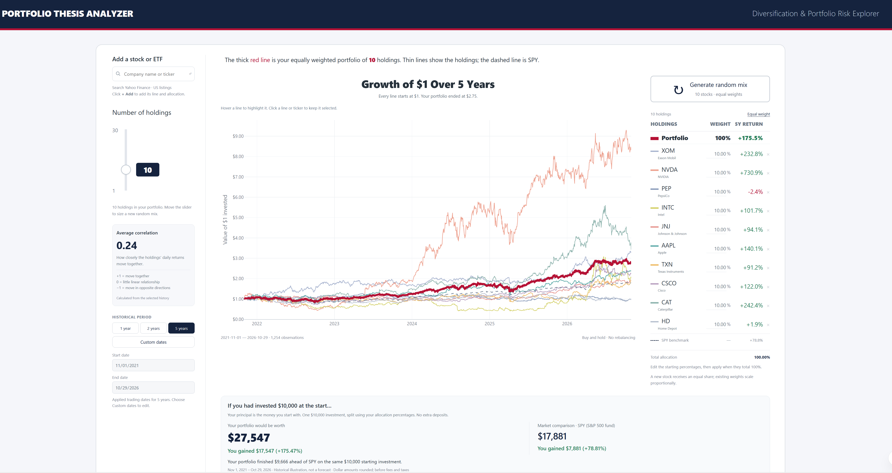
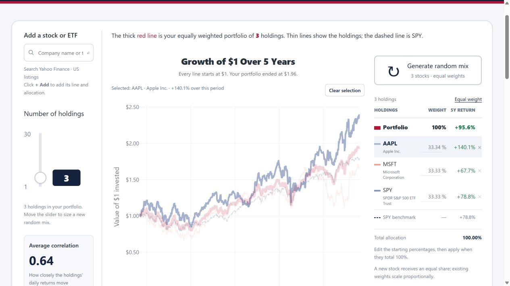
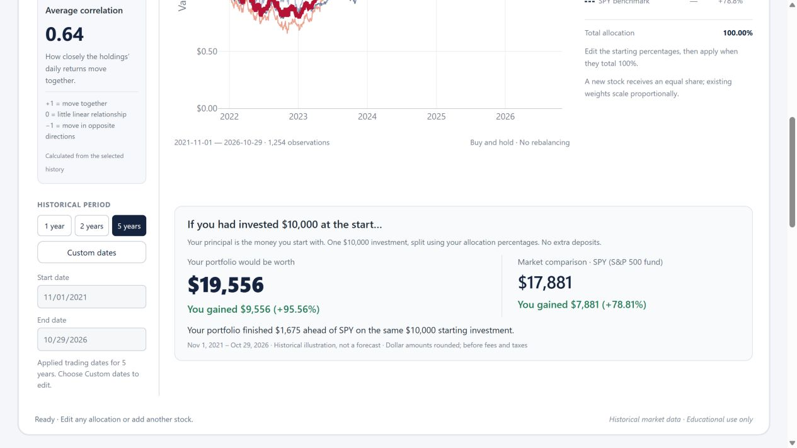

# Portfolio Thesis Analyzer

**FIN 471 — Project: Investment Portfolio Risk Analyzer**

[](https://raw.githubusercontent.com/dinozerg/portfolio-thesis-analyzer/main/screenshots/portfolio-overview.png)

*Click the screenshot to open the full-size image.*

**[▶ Play demonstration](https://www.awesomescreenshot.com/embed?id=57918894&shareKey=9ba6d82660079e865bfe5942cc3b9eb0)**

## What does the app do?

Investors can focus on a stock's gain while overlooking how the whole portfolio behaves. This application lets you choose stocks and ETFs, set starting weights, and see how those choices would have performed together using real historical prices.

Compare your portfolio with **SPY**, an ETF tracking the S&P 500, and explore three questions: **How much did it earn? How much did it fluctuate? How far did it fall?** The result supports an informed discussion of concentration and risk; it does not recommend investments or predict future returns.

[Run the app](#run-the-app) · [Visual walkthrough](#visual-walkthrough) · [Data and calculations](#data-and-calculations) · [Assignment coverage](#assignment-coverage)

## Visual walkthrough

### 1. Choose investments and set their weights

Search by company name or ticker using **Add a stock or ETF**, then click **+ Add**. Company names appear beside their tickers so you can identify each holding. Start with at least three securities for the class project.

In the holdings table, enter the starting percentages and click **Apply weights** when they total **100%**. Try the assignment example: **AAPL 40%, MSFT 35%, SPY 25%**. Draft changes leave the previous results in place until applied. **Equal weight** resets the mix; the × removes a holding and redistributes its allocation.

[](https://raw.githubusercontent.com/dinozerg/portfolio-thesis-analyzer/main/screenshots/company-names.png)

*Selecting AAPL highlights its performance line. This changes the display, not the portfolio weights.*

### 2. Read the chart and the dollar outcome

The **thick red line** represents your portfolio, the thin lines represent its holdings, and the dashed line represents SPY. Every series begins at **$1**, making different securities comparable. Hover over a line for values; click a line or ticker to keep it highlighted, and use **Clear selection** or Escape to reset.

Directly beneath the chart, the app translates the return into the ending value and gain or loss on a hypothetical **$10,000 starting investment**. SPY uses the same starting amount and dates.

[](https://raw.githubusercontent.com/dinozerg/portfolio-thesis-analyzer/main/screenshots/dollars-under-chart.png)

*This example shows the starting investment, ending value, dollar gain, percentage return, and market comparison together.*

Use **1 year**, **2 years**, **5 years**, or **Custom dates → Apply range** to change the analysis window. Dates are inclusive, with only common valid trading observations used. To explore another mix, change **Number of holdings** and click **Generate random mix**. Random mixes are experiments, not recommendations.

### 3. Compare risk, allocation, and the benchmark

The allocation donut shows where the starting money went. The risk cards and comparison table show whether the portfolio's return came with more volatility or a deeper decline than SPY.

[](https://raw.githubusercontent.com/dinozerg/portfolio-thesis-analyzer/main/screenshots/risk-allocation.png)

| Measure | What it helps you understand |
|---|---|
| Total return | The percentage gained or lost across the selected period |
| Annualized volatility | How much daily returns fluctuated, scaled to a trading year |
| Sharpe ratio | Return above the assumed risk-free rate relative to volatility |
| Maximum drawdown | The largest percentage loss from a previous portfolio peak |
| Average correlation | How closely the holdings' daily returns moved together |

Open **Assumptions, data & methodology** to review the calculation assumptions, change the annual risk-free rate, or refresh prices. The risk-free rate starts at **0%** as an editable assumption, not a live Treasury rate.

### 4. Explain the investment story

Below the chart, the app describes observed gains, the worst decline, and recovery milestones. You can add your reason for choosing the investments and compare a personal loss-tolerance input with the historical drawdown. Notes stay in the browser tab and reset on reload. The historical comparison is not a suitability assessment.

Screenshots show different demonstration portfolios and development checkpoints; compare values only when holdings, weights, and dates match. The opening image shows the latest supplied layout.

## Run the app

Install Python 3.12 and Git. In a terminal, clone the repository and enter its folder:

```powershell
git clone https://github.com/dinozerg/portfolio-thesis-analyzer.git
cd portfolio-thesis-analyzer
```

Python 3.12 is tested. From that folder:

```powershell
python -m venv .venv
.\.venv\Scripts\python.exe -m pip install -r requirements.txt
.\.venv\Scripts\python.exe app.py
```

Open **http://127.0.0.1:8501**. On the original development computer, the environment
is already installed: double-click **Start Portfolio.bat**. It opens the browser
after the server starts, or reopens the app if it is already running. Keep the terminal open;
Ctrl+C stops the server. On macOS/Linux use `.venv/bin/python` in place of
`.venv\Scripts\python.exe`. Recreate .venv rather than copying it between computers.

The redesign uses a small custom HTML/CSS/JavaScript interface and Python's built-in
HTTP server. **Streamlit is no longer required, and `streamlit run app.py` is no
longer the launch command.** No Node install/build, account, database, API key, or
paid AI API is required. Plotly JavaScript is served locally from the installed
Python package. Internet access is needed to search and download market data.

## Error handling

- Weights must total exactly 100%; invalid drafts cannot be applied. Duplicate securities and invalid dates are rejected.
- Price series are aligned to common valid dates without forward filling. Insufficient history produces an explanatory error.
- Failed searches and downloads show an error while preserving the last successful portfolio. No simulated data replaces unavailable prices.
- A matching previously downloaded dataset may be used during an outage, with a visible warning and its original retrieval timestamp. A fresh installation has no such fallback until a download succeeds.

## Assignment coverage

The selected topic is **Investment Portfolio Risk Analyzer**. It supports three or more stocks/ETFs, editable weights, portfolio returns, annualized volatility, Sharpe ratio, maximum drawdown, allocation and performance charts, and a market benchmark.

| Minimum functional requirement | How the app meets it |
|---|---|
| 1. Working application | Executable Python server and interactive browser interface; launch steps above |
| 2. Financial data integration | Yahoo Finance search and historical adjusted daily prices through `yfinance` |
| 3. User interaction | Security search, weights, date ranges, random mixes, and risk-free assumption |
| 4. At least three financial calculations | Total return, annualized volatility, Sharpe ratio, and maximum drawdown |
| 5. At least two visualizations | Historical performance line chart and allocation donut chart |
| 6. Error handling | Input validation, missing-data checks, visible provider errors, and labeled cache fallback |
| 7. Documentation | Purpose, illustrated features, API sources, formulas, and limitations in this README |
| 8. Reproducibility | Complete source, pinned dependencies, installation commands, and automated tests |

| GitHub submission requirement | Where to find it |
|---|---|
| Complete source code | Python modules and `web/` |
| README and dependencies | `README.md` and `requirements.txt` |
| Installation and run instructions | **Run the app** above |
| API and dataset documentation | **Data and calculations** below |
| At least two working-app screenshots | Four images in this README, stored in `screenshots/` |
| Financial concepts and calculations | Risk explanation above and expandable formulas below |
| AI coding-agent explanation | **Testing and AI-assisted development** below |
| Known limitations and incomplete features | **Limitations** below |
| Working demonstration | Video link at the top and demonstration sequence below |

**Repository to submit:** [github.com/dinozerg/portfolio-thesis-analyzer](https://github.com/dinozerg/portfolio-thesis-analyzer)

## Data and calculations

The app uses [yfinance](https://github.com/ranaroussi/yfinance), an unofficial client
for Yahoo Finance's market-data APIs:

The assignment allows an alternative historical-price source; Finnhub is suggested,
not mandatory. Live downloads and company search were successfully checked on
October 29, 2026, without an API key or paid subscription. The
[yfinance documentation](https://ranaroussi.github.io/yfinance/) identifies the
tool as intended for research and education and the Yahoo Finance API as intended
for personal use. This is a local educational prototype; that access should not
be read as permission to redistribute a market-data service.

- [`Search`](https://ranaroussi.github.io/yfinance/reference/api/yfinance.Search.html)
  searches company names/tickers and returns listings. Results are filtered to
  supported US stock/ETF exchanges; news and unrelated assets are omitted.
- [`download`](https://ranaroussi.github.io/yfinance/reference/api/yfinance.download.html)
  retrieves daily historical prices, `auto_adjust=True`, for 1-, 2-, or 5-year
  periods or explicit start/end dates. The UI's inclusive end date is translated
  to yfinance's exclusive end date by adding one calendar day. The same source supplies SPY.

Search and successful price responses are cached in memory for one hour. Successful
price downloads are also saved locally in ignored `.cache/` files. During outages,
only the identical requested symbol set and period (including both custom dates)
can use that snapshot; a warning
and original retrieval timestamp identify it. There is no synthetic substitution.
Refresh prices bypasses memory caching. Changed provider adjustments or retrieval
dates can change results; no guarantee of bit-for-bit future data reproducibility.

**Data rights:** yfinance's documentation describes personal research/educational
use and warns that Yahoo Finance data is intended for personal use. Availability
without a key is not a redistribution license. Public display rights are not yet
established; confirm terms or replace the adapter with a permitted source before
publishing. Code licensing and market-data rights are separate.

<details>
<summary><strong>Calculation formulas and assumptions</strong></summary>

For aligned adjusted price P(i,t), growth G(i,t) = P(i,t)/P(i,0).
Portfolio growth V(t) = sum(w(i) × G(i,t)), where w are the applied starting
weights summing to one. This is fractional-share **buy and hold**, not daily
rebalancing. Actual holdings' weights drift as prices change; the editor and donut
show starting allocations only. Adjusted close incorporates provider-reported
split and dividend adjustments, approximating reinvested distributions.

- Daily portfolio return: r(t) = V(t)/V(t-1) - 1.
- Total return: V(T)/V(0) - 1. This is the total over the displayed dates, not an
  annual return. The chart shows the dollar value of a $1 starting investment:
  $1.50 means a 50-cent gain, or a 50% total return. The headline scales the same
  portfolio series to a $10,000 starting investment and shows the dollar profit/loss.
- Annualized volatility: sample std(r), ddof=1, × sqrt(252).
- Daily risk-free rate: (1 + annual rate)^(1/252) - 1.
- Sharpe: mean(r − daily risk-free rate) / sample std(r) × sqrt(252).
  The default annual rate is an explicitly editable 0% simplifying assumption,
  not a live Treasury yield. Zero volatility gives N/A.
- Maximum drawdown: min(V(t)/running_max(V through t) − 1), including V(0).
  It is displayed as a negative loss.
- Correlation: unweighted mean of finite pairwise daily-return correlations among
  positive-weight holdings. It is historical, not user-specified or a forecast.
  Fewer than two eligible holdings yields N/A. Not a weighted covariance measure.
- SPY: identical calculations on exactly the same common dates. It may also be a
  holding; the benchmark series does not add an extra portfolio allocation.

No forward filling. Only dates with valid positive prices for every selected
holding and SPY are retained. Short-history stocks shorten the common window.
Missing interior dates can cause returns to span more than one trading day, so
252-observation annualization is then approximate. Actual dates, excluded counts,
and source timestamp are displayed. Latest bars may be provisional during trading.

The random equity universe is AAPL, MSFT, NVDA, AMZN, GOOGL, META, JPM, V, JNJ, UNH,
PG, KO, PEP, WMT, COST, XOM, CVX, CAT, HD, DIS, NFLX, ADBE, CRM, CSCO, INTC, AMD,
TXN, MCD, NKE, IBM. It is a convenience sample, not an optimized recommendation.
Company search is broader than this list. No currency conversion is implemented.

</details>

## Testing and AI-assisted development

```powershell
.\.venv\Scripts\python.exe -m unittest -v
```

Tests cover independent hand-worked returns, buy and hold versus rebalancing,
volatility and Sharpe, drawdown including initial capital, zero volatility,
risk-free assumptions, missing prices, cache fallback, exact 40/35/25 allocations,
add/remove redistribution, weight rounding, failed-request state preservation,
random uniqueness, one-stock portfolios, inclusive custom-date boundaries,
invalid/insufficient date ranges, rebasing to the selected window, date-specific
cache isolation, and filtering company-search results.

Validation on October 29, 2026: **26 automated tests passed**. A separate live
API check retrieved 251 aligned daily observations for the one-year AAPL/MSFT/SPY
40/35/25 example, calculated all four required return/risk measures, and confirmed
company search returned results. The price response was fresh, not an outage-cache
fallback. The local server, interface, and Plotly asset returned successful HTTP
responses, and the running browser displayed both charts and the FIN 471 footer.
The opening screenshot was supplied by the author after the latest layout update;
the risk/allocation screenshot was captured from the running app during validation.
These checks do not replace the student's working application demonstration.

OpenAI Codex implemented and iterated on the app from the user's README, assignment,
and screenshot. The first version used Streamlit; user feedback prompted a custom
interface for closer visual fidelity, real company search, and a clearer weight
editor. Code was executed, calculation tests run, and browser flows checked against
real downloaded data. AI output was validated rather than accepted on trust.

<details>
<summary><strong>Source files and local API routes</strong></summary>

- `app.py`: HTTP entry point, static assets and JSON routes; defaults to loopback only.
- `web/index.html`, `web/styles.css`, `web/main.js`: browser interface.
- `service.py`: validates state, changes allocations, assembles financial results.
- `portfolio.py`: price alignment, buy-and-hold calculations, and risk metrics.
- `market_data.py`: historical download, live search, and caching.
- `test_app.py`, `test_portfolio.py`: deterministic application/calculation tests.
- `requirements.txt`: pinned Python dependencies.

Local routes: `GET /api/search?q=company`, `POST /api/analyze`, and `GET /health`.
`/api/analyze` takes holdings, integer allocation basis points totaling 10,000,
period (`1y`, `2y`, `5y`, or `custom`), annual risk-free assumption, and an optional action.
Custom ranges also require `start_date` and `end_date` in YYYY-MM-DD form. Invalid requests
return a descriptive error; changes are committed to the UI only on success.
The built-in server is appropriate for this local prototype, not a production
multi-user hosting configuration. Public deployment remains a separate step.

</details>

## Demonstrate the prototype

1. Launch the app with AAPL, MSFT, and SPY, then apply **40% / 35% / 25%** weights.
2. Explain the selected dates, portfolio line, and $10,000 outcome compared with SPY.
3. Show the allocation donut, volatility, Sharpe ratio, and maximum drawdown.
4. Change weights or dates and explain how the results change. Search for and add another security.
5. Show that weights which do not total 100% cannot be applied. Explain data-source and historical-analysis limitations.

For a repeatable comparison, record the holdings, weights, custom dates, risk-free assumption, and retrieval time. Provider revisions can still change historical results. Submit the repository URL and follow the instructor's requirements for a recorded or live demonstration.

## Limitations

- Historical educational analysis only: no forecasts, trade execution, fees, taxes, slippage, or additional deposits and withdrawals.
- Buy and hold with fractional shares; weights drift after the initial allocation. The chart and editor show starting weights.
- US stock/ETF support; no currency conversion. Random mixes use a fixed 30-stock universe and have selection and survivorship bias.
- Yahoo Finance is an unofficial source accessed through `yfinance`; outages, limits, missing history, and revisions can affect results. Public data-display rights need separate review before hosting a public service.
- No persistent accounts or saved thesis notes. AI-generated investment theses and synthetic correlation simulations are not implemented or required by the selected project.
- The app runs locally. The shared recording demonstrates it, but is not a publicly hosted interactive application.

Never commit API keys, passwords, tokens, personal financial information, `.venv`, or `.cache`. Historical performance is not a prediction or personalized investment advice.
